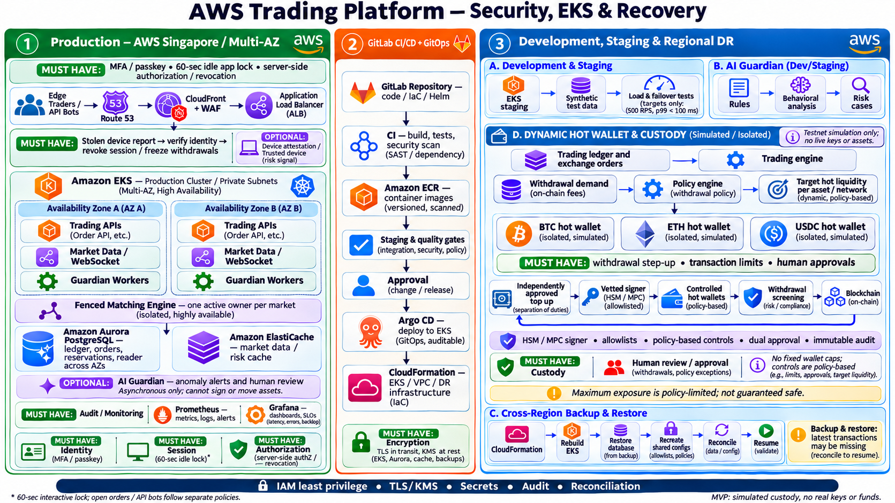
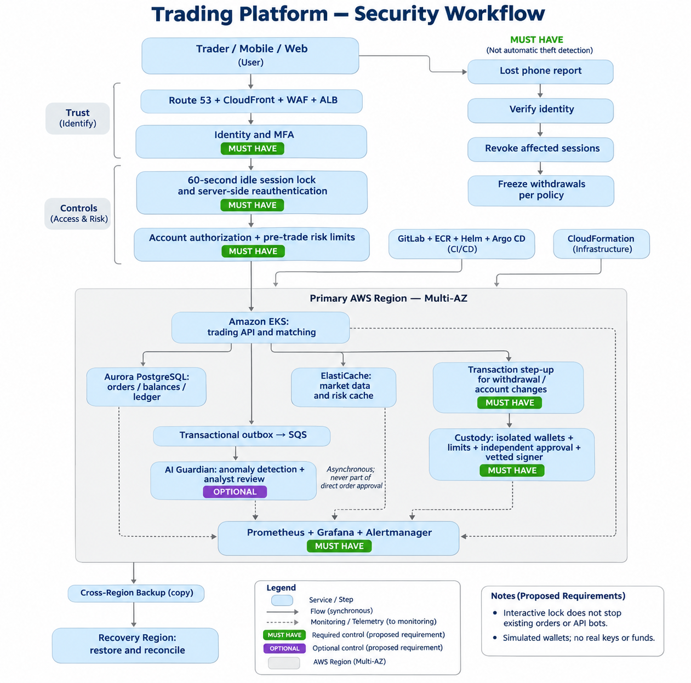

# 99Tech DevOps Challenge: Solutions

**Dzoan Nguyen Tran** · DevOps / SRE / Cloud Engineer

My answers to the [99Tech DevOps Challenge](https://s5tech.notion.site/DevOps-Challenge-19d48905ea77801db898d82997c8f4b2), built on the official skeletal template ([99techteam/devops-challenge](https://github.com/99techteam/devops-challenge)). Everything can be read directly on GitHub, with no ZIP to unpack. Each problem has a full PDF document (view or download) and a Markdown summary.

Mobile app https://100.31.100.157:3510/mobile


Full Exchange Demo ui is here 


main page https://100.31.100.157:3510/
live architecture : http://127.0.0.1:3510/ops.html#arch 
devops http://127.0.0.1:3510/ops.html
monitoring https://100.31.100.157:3510/ops.html#grafana


wallet security 
http://127.0.0.1:3510/ops.html#wallets


Defense http://127.0.0.1:3510/ops.html#attack


DR http://127.0.0.1:3510/ops.html#chaos


## At a glance

| # | Problem | Full document (PDF) | Summary | Status |
|---|---|---|---|---|
| 1 | Building Castle in the Cloud: HA crypto trading platform on AWS | 📄 [View PDF](docs/AWS_Trading_Platform_Dzoan-tran.pdf) · [⬇ Download](https://github.com/Sherlock2019/devopsprojects/raw/main/docs/AWS_Trading_Platform_Dzoan-tran.pdf) | [SOLUTION.md](src/problem1/SOLUTION.md) | ✅ **Complete** (design) |
| 2 | Diagnose Me Doctor: NGINX LB at 99% disk | 📄 [View PDF](docs/NGINX_Storage_Full_Incident_Report.pdf) · [⬇ Download](https://github.com/Sherlock2019/devopsprojects/raw/main/docs/NGINX_Storage_Full_Incident_Report.pdf) | [SOLUTION.md](src/problem2/SOLUTION.md) | ✅ **Complete** (method + illustrative worked incident) |
| 3 | Debugging issues within system: Docker Compose API | Code: [src/problem3/](src/problem3/) | [SOLUTION.md](src/problem3/SOLUTION.md) | ✅ **Fixed and tested**; task location to be confirmed ([see note](#problem-3-debugging-issues-within-system)) |
| 4 | Ship It Twice: GitHub Actions to EC2 + S3 | 📄 [View PDF](docs/Developer_Guide_AWS_CICD.pdf) · [⬇ Download](https://github.com/Sherlock2019/devopsprojects/raw/main/docs/Developer_Guide_AWS_CICD.pdf) | [SOLUTION.md](src/problem4/SOLUTION.md) | ✅ **Complete as code**: workflows + scripts, offline tests 14/14; not run against real AWS |
| 5 | Fortify the Castle: security for Problem 1 | 📄 [View PDF](docs/AWS_Trading_Platform_Security_Updated.pdf) · [⬇ Download](https://github.com/Sherlock2019/devopsprojects/raw/main/docs/AWS_Trading_Platform_Security_Updated.pdf) | [SOLUTION.md](src/problem5/SOLUTION.md) | ✅ **Complete** (design) |

**View PDF** opens the full document in GitHub's viewer; **⬇ Download** saves the file directly.

## Challenge instructions (from the challenge page)

1. Submit the application with the solutions attached or linked.
2. Each problem provides sufficient information to attempt it; note uncertainties and declare assumptions where necessary.
3. Minimally attempt the problems, even without a working solution.
4. Ignore any text with strike-through.
5. The challenge is broad and freeform by design; creativity is welcome where constraints are not clear.
6. Start with the skeletal template in the GitHub repo. The solution must be viewable without pain (unzipping counts as painful).

---

## Problem 1: Building Castle in the Cloud

**Time budget:** ≤ 12 hours.

**Task (from the challenge):** Architect a highly available trading system with features similar to Binance. It must be resilient to failures, scalable and cost-effective. Design the architecture, choose the technologies, and explain how high availability and scalability are maintained. Choose a subset of features that demonstrates mastery of cloud infrastructure.

**Required deliverables:**
- An overview diagram of the services used and the role each plays.
- Why each cloud service is used, and the alternatives considered.
- Plans for scaling beyond the current setup.

**Constraints:**

| Cloud provider | Throughput | Response time |
|---|---|---|
| AWS | 500 requests/second | p99 < 100 ms |

**What I delivered:**
- **Features chosen:** spot limit orders and cancel, matching, balances and a double-entry ledger, market data (REST + WebSocket), safety guardrails (limits, idempotency), monitoring. Also proposed: an asynchronous AI Guardian and simulated per-asset hot-wallet compartments.
- **Architecture:** Route 53 → CloudFront + WAF → ALB → **EKS across 2 AZs** (Order API, market data/WebSocket, matching engine with one fenced active owner per market, Guardian workers) → **Aurora PostgreSQL** (writer + reader) as the ledger, **ElastiCache** for market and risk cache, transactional outbox → **SQS**, Prometheus/Grafana/Alertmanager. Delivery via GitLab → ECR → Helm → Argo CD, and infrastructure via CloudFormation.
- **Service rationale:** a table of 16 functions, each with the selected service, benefit/trade-off and an alternative (for example ALB vs API Gateway, EKS vs ECS, Aurora vs RDS Multi-AZ, SQS vs MSK).
- **Resilience:** a failure-by-failure table covering pod, node, AZ, matching owner, DB failover, consumer lag and Region loss. Regional DR uses cross-Region backup and restore, with fencing and reconciliation before resuming.
- **Scaling plan:** HPA/Karpenter for API and WebSocket, matching sharded by market, consumers scaled on SQS queue age, Aurora writer scaled vertically before partitioning, then Global Accelerator or a second Region.
- **Performance test plan:** defines the 500 RPS / p99 measurement conditions (request mix, geography, duration, error threshold) and the k6/Locust approach.
- **Cost:** about **$1,351/month** partial baseline (Singapore, On-Demand).

**Limitations:** design only, nothing deployed. 500 RPS and p99 < 100 ms are targets, not measured results. Wallets are simulated.

📄 [Full PDF](docs/AWS_Trading_Platform_Dzoan-tran.pdf) · 📝 [Summary](src/problem1/SOLUTION.md)



---

## Problem 2: Diagnose Me Doctor

**Time budget:** ≤ 12 hours.

**Task (from the challenge):** Provide steps to troubleshoot two production issues.

**Scenario:** an Ubuntu 24.04 VM with 64 GB of storage runs only one service, an NGINX load balancer routing traffic to upstream services. Monitoring reports the VM consistently at **99% storage usage**.

**Challenge:** describe how you would troubleshoot, which causes and scenarios you expect, and the impact and recovery steps for each possible root cause.

**What I delivered:**
- **Kepner-Tregoe method:** situation appraisal → problem analysis (IS / IS NOT) → decision and recovery.
- **Incident flow:** open a ticket and inform the customer → assess impact and dependencies → **mitigate first** by draining the full LB to a healthy peer → diagnose with `df`, `df -i`, `du -x`, `lsof +L1`, `nginx -T` and logrotate checks → repair → validate end to end → customer confirmation → close and write the KB entry.
- **Possible causes, each with evidence, impact and recovery:** unrotated access/error logs, an upstream fault amplifying error logs, deleted-but-open files, proxy cache or temp files, journald and other logs, inode exhaustion, old kernels/apt/snap/core dumps, and unexpected or malicious activity.
- **Worked root cause:** an unrotated custom error log filled by a wrong upstream port, with the permanent fix, rollback plan and prevention alerts (time-to-full, logrotate failure).

**Note:** the worked incident is **illustrative**; only the VM, NGINX and the 99% alert come from the brief. The task mentions "two production issues" but the scenario describes one, so I recorded that ambiguity instead of inventing a second incident. The causes table covers the distinct root causes.

📄 [Full PDF](docs/NGINX_Storage_Full_Incident_Report.pdf) · 📝 [Summary](src/problem2/SOLUTION.md)

---

## Problem 3: Debugging issues within system

**Time budget:** ≤ 4 hours.

**Task (from the challenge):** "Reference README in Problem 4 repo."

> **Note on the instructions.** The challenge page gives no task beyond "Reference README in Problem 4 repo", and the repository README only contains general submission instructions. I checked the starter repository's folders. [`src/problem3/README.md`](src/problem3/README.md) is headed **"# Problem 4"** and contains a concrete debugging task: a Docker Compose platform whose API is "unreliable and sometimes inaccessible". The task is to identify the issues, fix them, explain the root causes, and report monitoring and prevention. I treated that file as the referenced README, followed it, and documented the investigation, changes and test results. I did not invent a scenario, and I did not reuse the Problem 2 NGINX incident.
>
> **Question for the recruiter:** "Problem 3 refers to the README in the Problem 4 repository, but the README I found only contains submission instructions. Could you please point me to the specific debugging task? I used `src/problem3/README.md` (headed "Problem 4", the Docker Compose API task) as the task. Please confirm whether that is the intended one."

**What I found and fixed (reproduced first, then re-tested):**

| # | Problem | Symptom | Fix |
|---|---|---|---|
| 1 | nginx `proxy_pass` → `api:3001`, API listens on `3000` | **100% 502** on `/api/*` | Correct upstream port |
| 2 | Unhandled `pg` Pool `'error'` event | **API process exits** when Postgres restarts | Pool and Redis error handlers |
| 3 | No restart policy | API stays down after a crash | `restart: unless-stopped` |
| 4 | `db.release()` skipped on query error | Connection leak → pool exhaustion | `pool.query()` |
| 5 | No timeouts, healthchecks or readiness | Hangs; requests during boot | Timeouts, healthchecks, `service_healthy` |
| 6 | Redis failure failed the request | 500 although DB was fine | Best-effort cache write, `/api/ready` |

**Results:** 200/200 sequential and 100/100 concurrent requests succeed (previously all 502). The API survives a Postgres restart, Postgres-down fails fast with 503 in ~50 ms, and Docker restarts an exited API. The summary also covers monitoring/alerts and production prevention.

```bash
cd src/problem3 && bash scripts/verify.sh   # Docker + Compose v2, port 8080
```

📝 [Summary](src/problem3/SOLUTION.md) · 💻 [Code](src/problem3/)

---

## Problem 4: Ship It Twice

**Time budget:** ≤ 6 hours.

**Context (from the challenge):** a web product with a **backend** HTTP API deployed to **EC2** and a **frontend** static SPA deployed to **S3**, both released manually today.

**Task:**
1. Design the pipelines.
2. Implement them as GitHub Actions workflows.
3. Decide what "production ready" means here, and make them that.

No real AWS account is needed; where something cannot run, implement it faithfully and explain what it would do.

**Required submission:** workflows, supporting files and a `SOLUTION.md` covering the assumptions made and why, how the pipelines work, and what was deliberately left out.

**What I delivered:**
- [`backend.yml`](src/problem4/.github/workflows/backend.yml):
  - PR checks: lint, test, `npm audit`, Docker build.
  - On merge: build once → smoke-test → push to ECR → resolve the digest → ECR scan gate.
  - Promotes the **same digest** dev → staging (+ E2E) → production, with required reviewers.
  - Manual rollback by digest.
- [`frontend.yml`](src/problem4/.github/workflows/frontend.yml):
  - PR checks: lint, test, audit, build, secret-string guard.
  - On merge: build once → checksum → artifact.
  - Each environment verifies the checksum, then publishes to S3 (assets first, then `index.html`), invalidates CloudFront and smoke-tests the served release.
  - Manual rollback by run ID.
- **Scripts:**
  - [`deploy-backend.sh`](src/problem4/scripts/deploy-backend.sh) deploys over **SSM** (no SSH), rejects non-digest images and prints host output.
  - [`ec2-deploy-container.sh`](src/problem4/scripts/ec2-deploy-container.sh) runs on the host and **rolls back automatically** if the health check fails.
  - [`deploy-frontend.sh`](src/problem4/scripts/deploy-frontend.sh) publishes the frontend.
- **"Production ready" defined as:**
  - build once, promote the same artifact;
  - OIDC short-lived roles per environment, with no stored AWS keys;
  - least-privilege `permissions:` and no AWS credentials in PR jobs;
  - environment approvals, per-environment concurrency, health-gated deploys with rollback;
  - scans, and runtime config kept out of the build.
- **Tests:** [`tests/run-tests.sh`](src/problem4/tests/run-tests.sh) runs a fake AWS CLI that simulates the SSM agent by running the real payload against local Docker. **14/14 passed.**

**Limitations:** the workflows live in the template's `src/problem4/.github/workflows/`, so they don't run in this repo; copy them to an app repo's root `.github/workflows/`. They haven't run against real AWS. `actionlint`/`shellcheck` were not run in the build environment. Single-host EC2 means a brief interruption per deploy.

📄 [Full PDF](docs/Developer_Guide_AWS_CICD.pdf) · 📝 [Summary](src/problem4/SOLUTION.md)

```bash
cd src/problem4 && bash tests/run-tests.sh   # bash, jq, curl, Docker; port 18081
```

---

## Problem 5: Fortify the Castle

**Task (from the challenge):** take the Problem 1 architecture and make it secure. Integrate security into the design rather than bolting it on. Show where the design changed, where something was added, and where the risk was accepted as it stood. Explain priorities (what to secure first, what to defer, what you would refuse to ship without). Where facts are missing, say what you would need, how you would get it, and what you assumed meanwhile.

**Required submission (`SOLUTION.md`):** the updated architecture with security changes marked, why each change is there and what it protects against, and what was deliberately left out with the trade-offs accepted.

**What I delivered:**
- **Priorities:** 1) user access, 2) funds and ledger, 3) platform, availability and recovery, 4) AI detection only on top of deterministic controls.
- **Marked architecture:** 🆕 added (trust chain of identity → 60 s lock → authorization, withdrawal step-up, lost-device flow). ✏️ changed (Guardian moved off the decision path, plus WAF, IRSA, KMS, private subnets and isolated backups). ✅ accepted risks.
- **18 controls, each marked MUST or OPTIONAL with threat and trade-off:**
  - Access: MFA/passkeys, a **server-enforced 60-second interactive lock**, lost-device revocation and withdrawal freeze, server-side authorization.
  - Funds: withdrawal step-up bound to the transaction, segregated wallets with an MPC/HSM signer, reconciliation.
  - Platform: IRSA, Secrets Manager, KMS/TLS, immutable audit, GuardDuty, CI/CD security, network isolation, backups.
  - Optional: AI Guardian and device attestation.
- **Key policies:**
  - Revocation is checked server-side, because a JWT alone isn't enough.
  - **Open orders and API bots follow separate policies** from the interactive lock.
  - The Guardian can never sign or move funds.
- **Covered in the summary:** missing facts and assumptions, deferred items, a **refuse-to-ship-without** list, and security acceptance tests.

**Limitations:** all controls are proposed. The MVP uses **simulated funds and signing** and is not a production custody system.

📄 [Full PDF](docs/AWS_Trading_Platform_Security_Updated.pdf) · 📝 [Summary](src/problem5/SOLUTION.md)



---

## What is proposed, simulated or tested

| Item | Nature |
|---|---|
| AWS trading architecture (P1) and security controls (P5) | **Proposed**, not deployed; 500 RPS / p99 < 100 ms are **targets, not measured** |
| Wallets, custody, signing (P1/P5) | **Simulated**, with no real funds or keys |
| NGINX incident (P2) | **Illustrative** worked example |
| Problem 3 fixes | **Tested** locally with Docker |
| CI/CD workflows and scripts (P4) | **Tested offline** (stubbed AWS CLI + local Docker); not run on GitHub runners or real AWS |

## Repository layout

```text
README.md                 this page
docs/                     full PDFs + diagrams (view / download)
src/problem1/SOLUTION.md
src/problem2/SOLUTION.md
src/problem3/             debugging task: code, fixes, SOLUTION.md, scripts/verify.sh
src/problem4/             SOLUTION.md, .github/workflows/{backend,frontend}.yml, scripts/, tests/
src/problem5/SOLUTION.md
```

The first commit is the unmodified template, so every change is visible in the history.

<details>
<summary>Original template README</summary>

# 99Tech DevOps Challenge #
Note that if you fork this repository, your responses may be publicly linked to this repo (DO NO FORK).
Please submit your application along with the solutions attached or linked.

It is important that you minimally attempt the problems, even if you do not arrive at a working solution.

## Submission ##
You can either provide a link to an online repository, attach the solution in your application, or whichever method you prefer. We're cool as long as we can view your solution without any pain.

</details>
