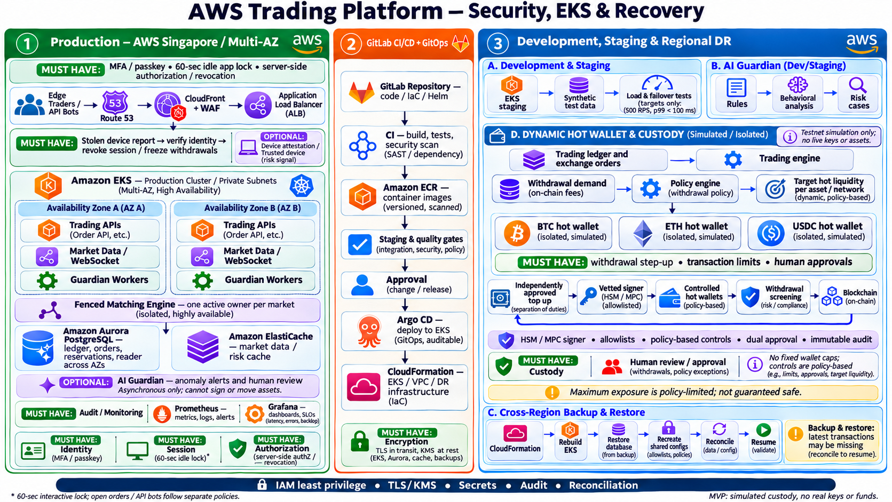
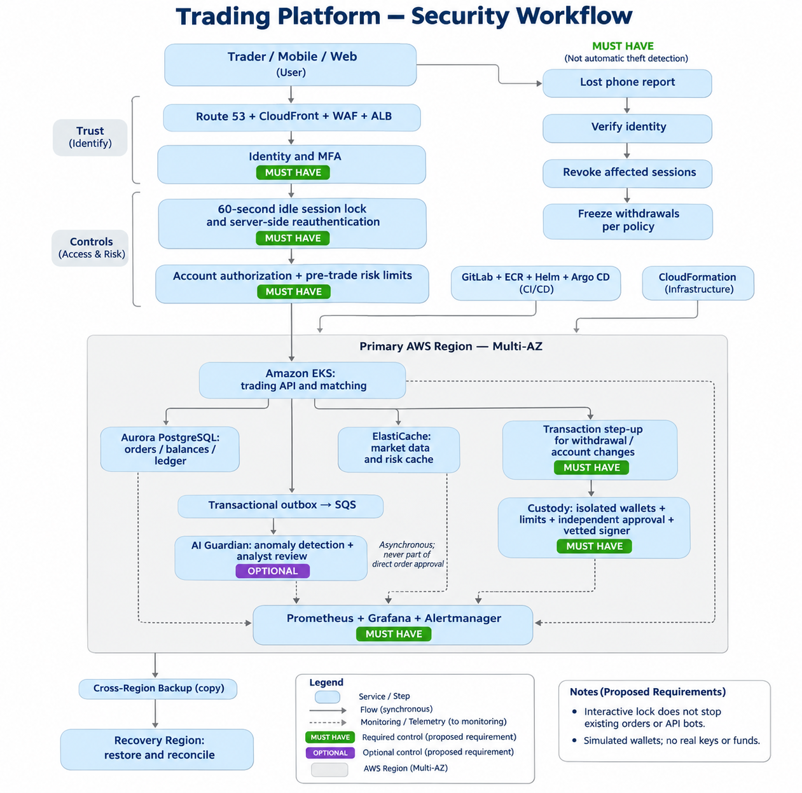

# Source documents

Full documents for each problem. **View** opens GitHub's built-in viewer; **⬇ Download** saves the file directly.

| Problem | Document | View | Download | Summary |
|---|---|---|---|---|
| 1 Building Castle in the Cloud | AWS_Trading_Platform_Dzoan-tran.pdf | 📄 [View](AWS_Trading_Platform_Dzoan-tran.pdf) | [⬇ Download](https://github.com/Sherlock2019/devopsprojects/raw/main/docs/AWS_Trading_Platform_Dzoan-tran.pdf) | [SOLUTION.md](../src/problem1/SOLUTION.md) |
| 2 Diagnose Me Doctor | NGINX_Storage_Full_Incident_Report.pdf | 📄 [View](NGINX_Storage_Full_Incident_Report.pdf) | [⬇ Download](https://github.com/Sherlock2019/devopsprojects/raw/main/docs/NGINX_Storage_Full_Incident_Report.pdf) | [SOLUTION.md](../src/problem2/SOLUTION.md) |
| 3 Debugging | code and report in [src/problem3](../src/problem3/) | | | [SOLUTION.md](../src/problem3/SOLUTION.md) |
| 4 Ship It Twice | Developer_Guide_AWS_CICD.pdf | 📄 [View](Developer_Guide_AWS_CICD.pdf) | [⬇ Download](https://github.com/Sherlock2019/devopsprojects/raw/main/docs/Developer_Guide_AWS_CICD.pdf) | [SOLUTION.md](../src/problem4/SOLUTION.md) |
| 5 Fortify the Castle | AWS_Trading_Platform_Security_Updated.pdf | 📄 [View](AWS_Trading_Platform_Security_Updated.pdf) | [⬇ Download](https://github.com/Sherlock2019/devopsprojects/raw/main/docs/AWS_Trading_Platform_Security_Updated.pdf) | [SOLUTION.md](../src/problem5/SOLUTION.md) |

## Diagrams

| Diagram | View | Download |
|---|---|---|
| AWS Trading Platform: Security, EKS & Recovery | [View](diagrams/aws-trading-platform-security-eks-recovery.png) | [⬇ Download](https://github.com/Sherlock2019/devopsprojects/raw/main/docs/diagrams/aws-trading-platform-security-eks-recovery.png) |
| Trading Platform: Security Workflow | [View](diagrams/trading-platform-security-workflow.png) | [⬇ Download](https://github.com/Sherlock2019/devopsprojects/raw/main/docs/diagrams/trading-platform-security-workflow.png) |

