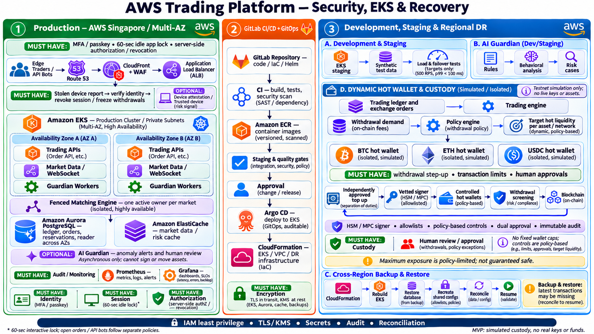
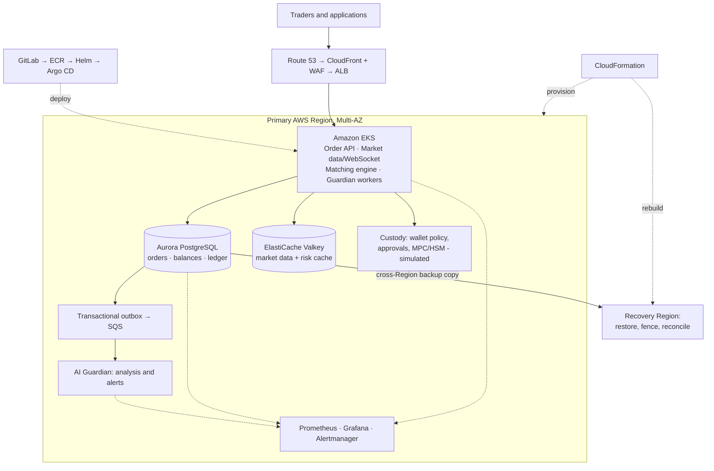
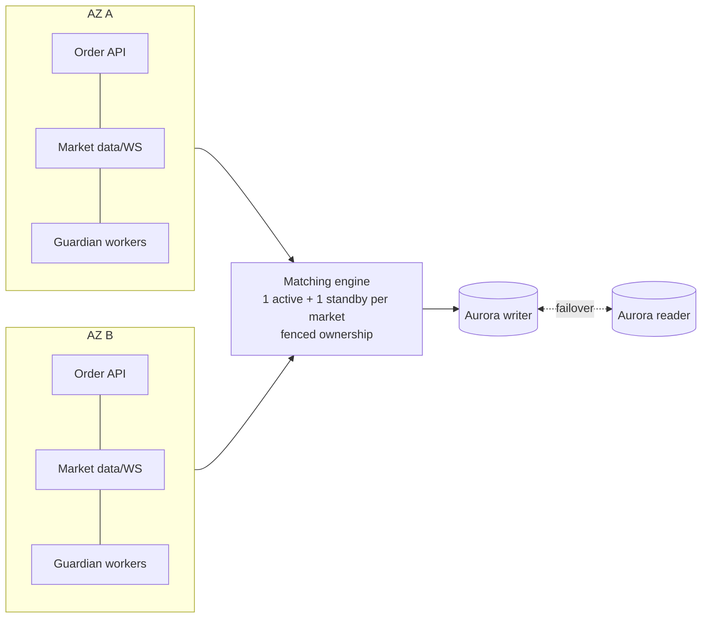

# Problem 1: Building Castle in the Cloud

**Highly available crypto spot-trading platform on AWS**

**Status: design complete (architecture, service choices, scaling and cost plan). Nothing is deployed, and the 500 RPS / p99 < 100 ms figures are targets, not measured results.**

📄 **Full document:** [AWS_Trading_Platform_Dzoan-tran.pdf](../../docs/AWS_Trading_Platform_Dzoan-tran.pdf) (*AWS Trading Platform: Scope of Work*, Dzoan Nguyen Tran, 12 Nov 2026). This page is a summary.

---

## 1. Challenge constraints

| Requirement | How this design answers it |
|---|---|
| Cloud provider | AWS only |
| Trading platform | Selected Binance-like features (section 2) |
| Throughput | **500 requests/s** mixed API workload (target) |
| Response time | **p99 < 100 ms**, measured end to end within an agreed geography (section 7) |
| Failure resilience | Multi-AZ, fenced matching owner, outbox, reconciliation (section 5) |
| High availability | Replicas across 2 AZs, Aurora failover, spare capacity for AZ loss |
| Scalability | Independent scaling for API, WebSocket, matching (per market) and data (section 6) |
| Cost-effectiveness | ~US$1,351/month partial baseline; managed services; DR as backup-and-restore (section 8) |

## 2. Selected features

| Feature | Purpose |
|---|---|
| Spot trading | Submit and cancel limit orders, match orders, view status |
| Balances and ledger | Available vs reserved balances, double-entry trade movements |
| Market data | Prices, order-book updates, recent trades (REST + WebSocket) |
| Safety guardrails | Order limits, balance checks, idempotency, duplicate prevention |
| AI Trading Guardian *(proposed addition)* | Asynchronous anomaly detection, risk cases, human review |
| Dynamic hot-wallet management *(simulated)* | Per-asset/network wallet compartments, liquidity targets, caps, approvals |
| Monitoring | Prometheus, Grafana, Alertmanager |

**Out of scope for the pilot:** live funds, real private keys, production custody, margin, derivatives, fiat rails, KYC/AML operations, token listing, regulatory certification.

### Trading requirements

| ID | Requirement |
|---|---|
| TR-01 | Authenticate users; authorize market, account and order access |
| TR-02 | Validate size and price increments, enforce limits, reserve balance atomically |
| TR-03 | Durably record the order with a unique client id; return `ACCEPTED` only after commit |
| TR-04 | Process commands in market order; **one fenced active owner per market**; cancel and partial fill |
| TR-05 | Record trades and balanced ledger entries transactionally; replay and reconcile after failure |
| TR-06 | Reliable **transactional outbox** → downstream consumers tolerate duplicates |
| TR-07 | Market data and history carry freshness; **the cache is never the ledger** |
| TR-08 | Audit evidence: actor, action, policy version, correlation id, decision |

## 3. Architecture overview

> Original diagrams: PDF pages 5–6. The detailed architecture with the security layers from [Problem 5](../problem5/SOLUTION.md) added:
>
> 
>
> Application workflow, redrawn from PDF page 5:

### Production layout (2 AZs, Singapore)

**Request path for an order:** ALB → Order API (auth, guardrails, idempotency key) → one Aurora transaction (reserve balance + insert order + outbox row) → `ACCEPTED` → matching owner for that market consumes in sequence → trades + ledger entries committed → outbox → SQS → read models, WebSocket fan-out, Guardian.

## 4. AWS services and alternatives

| Function | Selected | Benefit / trade-off | Alternative | Benefit / trade-off |
|---|---|---|---|---|
| DNS | Route 53 | Managed DNS / TTL affects failover | Route 53 + Global Accelerator | Static IPs, faster regional routing / extra cost |
| Content delivery | CloudFront | Edge caching / config and transfer cost | Direct S3 or ALB | Simpler / no edge caching |
| Web protection | WAF on CloudFront | Filters at the edge / rules need tuning | WAF on ALB | Regional protection / traffic reaches the Region first |
| API entry | Application Load Balancer | HTTP + WebSocket routing / API controls need design | API Gateway | Managed API controls / extra cost and latency to test |
| Customer identity | Cognito | Managed auth / integration constraints | External IdP | Flexible / vendor and integration cost |
| Containers | EKS | Kubernetes ecosystem / cluster operations | ECS | Simpler / less portability |
| Compute | EKS managed EC2 nodes | Node control / capacity and patching | EKS on Fargate | Less node management / less host control |
| Database | Aurora PostgreSQL | Transactions + fast failover / cost, perf testing | RDS PostgreSQL Multi-AZ | Managed PG / different scaling and failover |
| Cache | ElastiCache | Fast reads / cache consistency | DynamoDB | Managed KV / different access patterns |
| Events | SQS | Managed queues / limited replay | MSK | Streaming + replay / more complexity |
| Registry | ECR | AWS-integrated / storage and replication cost | GitLab Registry | GitLab-integrated / GitLab dependency |
| Monitoring | Prometheus + Grafana on EKS | Full control / team runs the stack | Amazon Managed Prometheus + Grafana | Less admin / service charges |
| IaC | CloudFormation | AWS-native / template maintenance | AWS CDK | Reusable code / extra tooling |
| AZ recovery | Multi-AZ EKS + Aurora | AZ resilience / higher capacity cost | Single AZ | Cheaper / AZ failure = outage |
| Regional DR | Cross-Region backup and restore | Low cost / slower recovery, possible data loss | Aurora Global DB + pilot light | Faster recovery / higher cost, data loss still possible |
| Wallet custody | Vetted custody provider or MPC/HSM | Controlled signing / provider evaluation | Custom CloudHSM custody | More control / much more security responsibility |

## 5. Availability, failure resilience and DR

| Failure | Behaviour |
|---|---|
| Pod crash | Kubernetes restarts it; ≥ 2 replicas behind ALB; PodDisruptionBudgets |
| Node loss | Managed node group replaces the node; topology spread keeps replicas across AZs |
| **AZ loss** | Surviving AZ carries traffic (spare capacity provisioned for it); Aurora promotes the reader; matching standby takes ownership **only after fencing** the old owner, so trades are never duplicated |
| Matching-engine owner failure | Lease/fencing token; standby replays committed commands from the ledger, then resumes |
| DB failover | Aurora failover; in-flight requests retry with idempotency keys |
| Consumer/Guardian lag | SQS buffers; consumers are idempotent; Guardian is off the order path |
| **Region loss** | Cross-Region backup copies → rebuild EKS and apps via CloudFormation + GitOps → restore DB → **fence old primary** → reconcile orders and balances → approved, controlled resume. Snapshot RPO is non-zero: recent records may be missing and must be reconciled. |

## 6. Scaling plan (beyond the initial setup)

- **API and WebSocket:** HPA on request latency, CPU and connection count; Cluster Autoscaler or Karpenter adds nodes.
- **Matching:** shard by market; one fenced active owner per market; hot markets get dedicated capacity and their own load tests.
- **Events and Guardian:** scale consumers on SQS queue age; move to MSK if replay or stream fan-out becomes a requirement.
- **Data:** cache suitable reads → optimise transactions → scale Aurora writer vertically → only then partition (for example by market or account). Readers lag, so they are never used for balance checks.
- **Geography:** CloudFront at the edge; Global Accelerator; then a second active Region only with a matching-ownership model per market.
- **Availability while scaling:** test the 500 RPS baseline **and** degraded mode with one AZ down.

## 7. Performance target and how to test it

- **Target:** 500 RPS mixed workload (for example 60% market-data reads, 30% order submit/cancel, 10% account queries), **p99 < 100 ms** measured at the ALB and at a client inside the agreed geography (Singapore), error rate < 0.1%, over a 30-minute steady run plus a ramp.
- **Tooling:** k6 or Locust from EC2 in the same Region (server latency) and from the target client geography (end-to-end).
- **Separate tests:** WebSocket fan-out, wallet paths, AZ failure during load, Aurora failover during load.
- **Evidence:** latency histograms, saturation (CPU, DB connections, queue age) and bottleneck report. **Not yet run.**

## 8. Starting size and indicative cost (Singapore, On-Demand, 730 h)

| Component | Starting size | ~OPEX / month |
|---|---|---|
| EKS control plane | 1 cluster | ~$73 |
| EKS worker nodes | 4 × m7i.xlarge (2 per AZ) | ~$736 |
| Order API / WebSocket / Matching / Guardian | 2 pods each; matching 1 active + 1 standby per market | included in nodes |
| Aurora PostgreSQL | 1 writer + 1 reader, db.r7g.large | ~$486 (+ storage, I/O, backups) |
| ElastiCache | 1 primary + 1 replica, cache.t4g.small Valkey | ~$56 |
| SQS, edge, NAT, data transfer, logs, DR copies | usage-based | estimate separately |
| **Partial baseline** | | **≈ $1,351 / month** |

This is a partial estimate, not total cost; confirm in the AWS Pricing Calculator. Savings Plans or Reserved Instances on nodes and Aurora are the first cost lever once sizing is validated.

## 9. Delivery phases

| Phase | Duration | Output |
|---|---|---|
| 0 Discovery | 1–2 wk | Requirements, traffic assumptions, risk policy, test plan |
| 1 Trading foundation | 2–3 wk | Simulated orders and ledger, EKS, CI/CD, dashboards |
| 2 Guardian + wallet simulator | 2–3 wk | Rule-based Guardian, simulated compartments, approvals, reconciliation |
| 3 Performance and cost | 1–2 wk | 500 RPS / p99 test, bottlenecks, measured cost |
| 4 Scaling | 1–2 wk | Scale pods, nodes, DB and workers; document limits |
| 5 Resilience | 1–2 wk | AZ and Regional recovery tests, runbooks |
| 6 Production readiness | separate scope | Independent custody and security review, launch decision |

## 10. Assumptions and limitations

- 500 RPS and p99 < 100 ms are **targets**; they depend on request mix, geography and error threshold, and **have not been benchmarked**.
- Multi-AZ covers AZ outages; cross-Region restore can lose recent transactions and needs reconciliation.
- Wallets and signing are **simulated**: no real keys or funds.
- Costs exclude variable and supporting charges.
- **Demo:** no deployed demo exists for this design yet.

Security hardening of this architecture is in [Problem 5](../problem5/SOLUTION.md).
