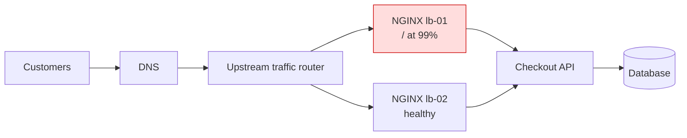

# Problem 2: Diagnose Me Doctor

**NGINX load balancer at 99% disk on an Ubuntu 24.04 VM (64 GB)**

**Status: complete as a troubleshooting method plus a worked example.**

> **Read this first.** The challenge supplies only these facts: an Ubuntu 24.04 VM with 64 GB of storage, running NGINX as a load balancer, and a 99% storage alert. **Everything in the worked example (customer, lb-01/lb-02, ticket ID, timeline, file sizes, ports, outputs) is illustrative**, built to show the method. It is not a real incident or a verified outcome.
>
> **Ambiguity noted:** my brief mentions "two production issues", but the material available to me describes one scenario. I have not invented a second incident; section 6 covers the full set of plausible causes instead.

Method: Kepner-Tregoe (KT) situation appraisal → problem analysis (IS / IS NOT) → decision and recovery. Source: *Production Incident Report for NGINX Disk Exhaustion* (see [`docs/`](../../docs/README.md)).

---

## 1. Order of work

1. **Open a ticket and inform the customer:** time, component, impact, severity, owner, next update time.
2. **Assess impact:** are dependent services down, slow or unaffected?
3. **Map dependencies:** where the LB sits and what traffic it carries.
4. **Mitigate first:** route traffic to a healthy alternative if one exists (reversible, fastest).
5. **Diagnose:** disk vs inodes, what is consuming space, why.
6. **Test competing causes** against evidence.
7. **Repair and permanent fix**, under change control with rollback.
8. **Validate** the customer-to-backend path, confirm with the customer, close the ticket, update the KB.

## 2. Ticket and first customer update

Example ticket `INC-EXAMPLE-001`: SEV-2 assumed, owner on-call DevOps.

> "We are investigating degraded checkout performance. Our team is assessing the load-balancing path and working to restore service. We will provide an update by 09:15 ICT. Reference: INC-EXAMPLE-001."

Don't claim a cause or restoration time until evidence supports it.

## 3. Situation appraisal and dependency map



*(The upstream router, lb-02 and checkout API are assumptions for the example.)*

| Question | Illustrative finding |
|---|---|
| Down or slow? | Some lb-01 requests return 502 or time out; lb-02 path works |
| Who is affected? | Checkout clients routed via lb-01; exact count unknown |
| Bottleneck? | `/` on lb-01 at 99%; its upstream connections also fail |
| Workaround? | lb-02 has healthy targets, same routes and certs, enough capacity |
| What to protect? | Customer traffic, incident evidence, NGINX availability, rollback ability |

## 4. Mitigate first: drain lb-01

Before draining, verify on lb-02: health, capacity for 100% of traffic, server names, routes, TLS certificates and reachability to the API. Drain lb-01 through the existing router or LB automation, consider sticky sessions and DNS TTL, validate checkout, then tell the customer:

> "We routed checkout traffic to a healthy load balancer. Our checks show service has improved; we are investigating the original server and will update you by 09:45 ICT."

**Why rerouting first:** it is reversible and restores customers faster than repairing a nearly full live VM. If there is no healthy peer, recover safe disk headroom on the live node while you watch traffic.

## 5. Diagnose: evidence collection

```bash
df -hT                     # which filesystem is full
df -i                      # inode exhaustion?
findmnt -T /var/log/nginx  # is /var/log on the same mount?
lsblk -f
sudo systemctl status nginx --no-pager
sudo ss -lntp

sudo du -xhd1 / 2>/dev/null | sort -h          # -x: stay on this filesystem
sudo du -xhd1 /var/log 2>/dev/null | sort -h
sudo ls -lh /var/log/nginx/
sudo lsof +L1                                  # deleted-but-open files
sudo journalctl --disk-usage

sudo nginx -t
sudo nginx -T 2>/dev/null | grep -E "access_log|error_log|proxy_pass|upstream"
sudo cat /etc/logrotate.d/nginx
sudo systemctl status logrotate.timer logrotate.service --no-pager
```

NGINX config and logs can hold sensitive data, so put only sanitized evidence in the ticket.

### KT problem analysis: IS / IS NOT (illustrative)

| Dimension | IS | IS NOT, and the distinction |
|---|---|---|
| What | `/` bytes 99% used; NGINX logs upstream connection errors | Inodes not exhausted (12%) |
| Where | lb-01 root FS; a custom error log is ~46 GiB | lb-02 healthy and serving checkout |
| When | Growth began after a config deployment | Baseline normal before the change (timing is a clue, not proof) |
| Extent | One VM; the error log is most of the used space | No alert on lb-02; other mounts healthy |

## 6. Possible causes, evidence, impact and remedies

| Cause | Evidence that confirms it | Impact | Remedy |
|---|---|---|---|
| **Access/error log not rotated** (custom path missing from logrotate, or logrotate timer failing) | `du` points at `/var/log/nginx`; `nginx -T` shows a log path not covered by `/etc/logrotate.d/nginx` | Disk fills; NGINX can fail to write logs or temp files → 5xx | Add the path to logrotate (`daily`, `rotate N`, `compress`, `postrotate` → `nginx -s reopen`); ship logs centrally |
| **Upstream fault amplifying error logs** (wrong port, dead backend) | Repeated `connect() failed (111)`; config differs from peer | Customer errors + log flood | Fix upstream config; rate-limit or lower error log level |
| **Deleted file still held open** | `df` used ≫ `du` total; `lsof +L1` lists large deleted files | Space not freed after `rm` | `nginx -s reopen` (or reload) to release handles; never `rm` live logs, truncate if you must |
| **Proxy cache / temp files** (`proxy_cache_path`, `client_body_temp`) | Large `/var/cache/nginx` or temp dirs | Disk fills under large uploads/caching | Set `max_size` / `inactive` on cache; size temp paths; separate volume |
| **systemd journal / other logs** | `journalctl --disk-usage` large; `/var/log/syslog` large | Same | `SystemMaxUse=` in journald.conf; `journalctl --vacuum-size` |
| **Inode exhaustion** | `df -i` at 100% while bytes are free | Cannot create files | Find dirs with millions of small files; clean; reprovision FS |
| **Old kernels / apt cache / snaps / core dumps** | `/boot`, `/var/cache/apt`, `/var/lib/snapd`, `/var/crash` large | Slow creep | `apt clean`, `apt autoremove`, snap retention, disable core dumps |
| **Unexpected activity** (abuse, attack, unknown files) | Unknown files or processes, abnormal source volumes | Security incident | Preserve evidence, escalate to security, rate-limit/WAF |

## 7. Worked root cause (illustrative)

- **Supported:** lb-01 proxies checkout to **port 8081** while the approved service listens on **8080** (lb-02 uses 8080). Each request logs `connection refused`.
- **Supported:** that custom error-log path is **absent from the effective logrotate rules**, so it grew to ~46 GiB.
- **Not supported:** deleted-open files (`lsof +L1` clean), journal or cache (small), inodes (12%), unexpected activity (none seen).

**Causal chain:** bad upstream port → customer request failures **and** high error-log volume → unrotated log → disk full. Each link was checked with effective config, a connection test, the log pattern and disk attribution, not inferred from timing.

```bash
curl --connect-timeout 2 --max-time 5 http://UPSTREAM_HOST:8080/health   # placeholder host
```

## 8. Repair

**Immediate headroom:** preserve required evidence, then delete only an **approved, inactive** rotated archive. In the example, an 8 GiB `.gz` brings usage from 99% to ~86%.

```bash
sudo rm -i -- /var/log/nginx/APPROVED_OLD_ARCHIVE.gz   # placeholder; never active or unidentified files
df -hT
```

**Permanent fixes (under approved change, with rollback):**

1. Correct the upstream port in the source-controlled config → `sudo nginx -t` → approved `reload` (not restart) → verify routes and TLS unchanged.
2. Add the custom log to logrotate with retention, permissions and a reopen step:
   ```bash
   sudo nginx -t
   sudo logrotate -d /etc/logrotate.conf   # dry run
   sudo logrotate /etc/logrotate.conf      # rotates only when due; forced rotation is a separate decision
   ```
3. Find out how the bad port was introduced; add config review and a deploy-time smoke test against the expected upstream.

**Rollback:** keep the previous known-good config and change ID. If the error rate rises after reload, drain the node and restore it.

## 9. Validate, confirm, close

| Check | Expected |
|---|---|
| Disk / inodes | ~86% and stable; inodes healthy |
| NGINX | `nginx -t` passes; active; log writable |
| Upstream | Approved port; health check succeeds |
| Logging | Rotation covers the custom path; dry run and reopen verified |
| Customer path | Synthetic checkout succeeds through lb-01 **and** lb-02 |
| Traffic | Returned gradually to lb-01; errors and latency back to baseline for an agreed window |

> "We corrected the load-balancer configuration and recovered disk capacity. Our end-to-end tests are passing. Please confirm checkout works for you; we are monitoring the service."

Close only after real customer confirmation, per policy. If there is no reply, record "pending confirmation" and follow the closure rules. Unfinished permanent work goes to a problem or change record with an owner and due date.

### Example timeline (ICT, UTC+7, invented)

| Time | Action |
|---|---|
| 09:00 | Disk alert; ticket opened |
| 09:05 | Customer informed |
| 09:10 | lb-01 drained; checkout validated via lb-02 |
| 09:16–09:31 | Evidence; log growth and wrong upstream port identified |
| 09:38 | Approved archive removed; headroom regained |
| 09:48 | Upstream + logrotate corrected under change |
| 10:10 | Small traffic share returned to lb-01 |
| 10:20 | Customer confirms |
| 10:30 | Ticket closed; KB published |

## 10. Prevention and KB entry

| Action | Owner (example) |
|---|---|
| Custom log path under managed rotation | Platform engineer |
| Correct upstream + automated deploy smoke test | App and platform owners |
| Alerts: disk %, **time-to-full**, inodes, error rate, logrotate failure | Observability owner |
| LB failover and surviving-capacity game day | SRE owner |
| Sanitized incident article (KT table, commands, rejected hypotheses, fix, validation) | Incident owner |

No credentials, customer data or unredacted logs go in the KB.

**References:** [NGINX control / log reopening](https://nginx.org/en/docs/control.html) · [Ubuntu 24.04 logrotate(8)](https://manpages.ubuntu.com/manpages/noble/man8/logrotate.8.html) · [Ubuntu 24.04 df(1)](https://manpages.ubuntu.com/manpages/noble/man1/df.1.html)
