# Problem 4: Ship It Twice

**GitHub Actions CI/CD: backend HTTP API → EC2, frontend static app → S3 (+ CloudFront)**

**Status: complete as code. Workflows and deploy scripts are written, statically checked and tested offline (14/14 passing). They have not yet run on GitHub-hosted runners against a real AWS account.**

## Deliverables

| File | What it does |
|---|---|
| [`.github/workflows/backend.yml`](.github/workflows/backend.yml) | PR: lint, test, `npm audit`, Docker build. Merge: build **once** → smoke-test container → push to ECR → resolve **digest** → ECR scan gate (CRITICAL fails) → release manifest → dev → staging (+ E2E) → production. Manual dispatch = redeploy/rollback any digest to any env |
| [`.github/workflows/frontend.yml`](.github/workflows/frontend.yml) | PR: lint, test, audit, build, secret-string guard. Merge: build **once** → checksum → artifact → dev → staging → production, each **verifying the checksum** before publishing. Manual dispatch = redeploy/rollback an earlier run's artifact |
| [`scripts/deploy-backend.sh`](scripts/deploy-backend.sh) | Runner side: refuses non-digest images, ships the host script via **SSM Run Command** (no SSH), waits, prints host output, public smoke test |
| [`scripts/ec2-deploy-container.sh`](scripts/ec2-deploy-container.sh) | EC2 side: ECR login, pull, runtime env from SSM Parameter Store, replace container, local health check, **automatic rollback** to the previous image, log rotation on the container |
| [`scripts/deploy-frontend.sh`](scripts/deploy-frontend.sh) | Writes per-env `config.json`, uploads hashed assets (immutable cache) **before** switching `index.html` (no-cache), CloudFront invalidation + wait, prunes old files last, verifies the served release |
| [`tests/run-tests.sh`](tests/run-tests.sh) + [`tests/aws-stub/aws`](tests/aws-stub/aws) | Offline tests with a fake AWS CLI that simulates the SSM agent by executing the real payload against local Docker |

> **Where workflows must live to run:** GitHub Actions only discovers workflows in `.github/workflows/` at the **repository root**. They sit under `src/problem4/.github/workflows/` here because that is the template's layout, so they are **intentionally inactive in this repo**. To use them, copy them into an application repo with this layout:
> ```text
> .github/workflows/backend.yml, frontend.yml
> backend/    package.json (lint, test, optional test:e2e), package-lock.json, Dockerfile, GET /health
> frontend/   package.json (lint, test, build → dist/), package-lock.json; SPA loads /config.json at startup
> scripts/    deploy-backend.sh, ec2-deploy-container.sh, deploy-frontend.sh
> ```
> Then create the GitHub environments and variables (section 7) and the AWS resources and roles.
>
> **Single-repo vs three-repo model:** these workflows implement promotion inside one repo, using **GitHub Environment required reviewers** on `staging` and `production` as the tech-lead gate. The separate staging/production *deploy repositories* with promotion PRs (section 4) are the proposed next step; the same scripts work there unchanged.

📄 **Full document:** [Developer_Guide_AWS_CICD.pdf](../../docs/Developer_Guide_AWS_CICD.pdf) (*Developer Guide for AWS CI/CD*).

---

## 1. Problem and approach

| Today | Proposed |
|---|---|
| Manual releases; steps vary by developer | GitHub Actions builds, tests and deploys through consistent procedures |
| Easy to miss a test or ship the wrong version | **Build once**: an immutable release = source commit + backend image digest + frontend artifact checksum |
| No consistent review path for staging/prod | Tech lead reviews **promotion PRs** into protected staging and production deploy repos |
| Recovery depends on memory | Documented known-good release, rollback runbook and verification |

No pipeline guarantees error-free code; validation, monitoring and rollback remain necessary.

## 2. Assumptions

| Assumption | Why |
|---|---|
| Backend is a containerised Node.js HTTP API (`npm ci / lint / test`, `Dockerfile`) | The challenge gives no code; Node + container is the most common shape and makes digest promotion straightforward |
| Backend runs on a single EC2 host per environment, deployed via **SSM Run Command** (no SSH keys) | Matches "HTTP API on EC2" with no inbound SSH; a single host means **brief downtime per deploy** (not claimed as zero-downtime) |
| Frontend is an SPA (`npm run build` → static files) hosted on **S3 behind CloudFront** | Standard static hosting; CloudFront gives TLS and caching; invalidate on deploy |
| AWS access via **GitHub OIDC → short-lived IAM roles**, one per environment | No long-lived AWS keys in GitHub secrets |
| Separate AWS accounts (or equivalent isolation) for dev, staging, prod | Blast-radius control; prod credentials never reachable from dev jobs |
| Runtime config (API base URL, flags) is injected at deploy, **not** baked into the build | Lets the *same* artifact be promoted across environments |

## 3. Environments

| Env | Purpose | Resources |
|---|---|---|
| Development | Validate changes | Dev account; dev EC2 API; dev S3 + CloudFront; synthetic data |
| Staging | Test the *same* release production-like | Staging account; staging EC2, S3/CloudFront, IAM; non-prod data |
| Production | Real users | Prod account; restricted IAM; monitoring; backups |

## 4. Repository and review model (proposed extension)

| Repo | Contents | Review |
|---|---|---|
| `application-repo` | Backend + frontend source, tests, Dockerfile, build workflow | Normal team review into `main` |
| `staging-deploy-repo` | Staging deploy workflow, env config, **release manifest** | **Tech lead** code-owner review into protected `main` |
| `production-deploy-repo` | Production deploy workflow, env config, release manifest | **Tech lead** code-owner review into protected `main` |

Deploy repos hold **artifact references**, not copies of the source. Rulesets on their `main`: required checks, CODEOWNERS (tech lead), dismiss stale approvals, no direct push or bypass.

## 5. Pipeline flow

```mermaid
flowchart LR
    A[Feature branch] --> B[PR to application-repo<br/>lint · test · scans]
    B -->|review + green| C[Merge to main]
    C --> D[Build ONCE<br/>image digest + FE checksum]
    D --> E[Deploy DEV<br/>OIDC dev role · SSM→EC2 · S3+CF]
    E -->|smoke + integration pass| F[Promotion PR<br/>staging-deploy-repo]
    F -->|tech lead approves| G[Deploy STAGING<br/>same digests]
    G -->|E2E · security · perf pass| H[Promotion PR<br/>production-deploy-repo]
    H -->|tech lead approves<br/>+ env gate| I[Deploy PROD]
    I --> J{Healthy?}
    J -->|yes| K[Record release]
    J -->|no| L[Rollback to known-good]
```



| Stage | Checks / deployment | If it fails |
|---|---|---|
| PR CI | Locked deps; lint, unit, integration tests; dependency + secret scans | Don't merge. **PR jobs have no AWS credentials.** |
| Build | Build + smoke-test backend image; build + validate frontend; record immutable IDs | No promotable release |
| DEV | OIDC dev role; EC2 via SSM; S3 sync + CloudFront invalidation; smoke/integration tests | Stop; fix; new candidate |
| STAGING | Tech-lead PR approval; deploy exact artifacts; acceptance tests | Stop; new candidate |
| PROD | Tech-lead PR approval; GitHub Environment gate (if plan supports it); deploy + verify | Stop; rollback; incident if needed |

A PR approval (repo merge) and a GitHub Environment approval (deployment gate) are **different controls**. Environment reviewers on private repos depend on the GitHub plan, so verify the entitlement. The tech lead cannot approve a failed test into a pass.

## 6. How each workflow is meant to operate

### Backend → EC2
1. **CI (on PR):** `npm ci && npm run lint && npm test`; dependency review; secret scan.
2. **Build (on merge to main):** `docker build` → smoke-run container → push to ECR → record `sha256` digest + commit SHA + run ID in a release manifest.
3. **Deploy (per environment):** `aws-actions/configure-aws-credentials` with OIDC role → `aws ssm send-command` on the target instance: pull the image **by digest**, fetch secrets from Secrets Manager/SSM Parameter Store on the host, replace the container, health-check `/health`.
4. **Rollback:** redeploy the previous known-good digest from the manifest.

### Frontend → S3
1. **CI (on PR):** `npm ci && npm run lint && npm test && npm run build`.
2. **Build:** produce `dist/`, compute checksum, upload as a GitHub artifact kept 90 days. For longer rollback windows, copy it to a durable S3 artifact bucket.
3. **Deploy:** OIDC role → verify checksum → write per-environment `config.json` (API URL and non-secret flags only) → upload hashed assets with long cache headers → switch `index.html` / `config.json` with `no-cache` → CloudFront invalidation → prune old files → smoke test that the served `config.json` has this release.
4. **Rollback:** re-sync the previous artifact and invalidate. This does **not** undo database changes.

## 7. Required GitHub and AWS configuration

**GitHub environments:** `dev`, `staging`, `production` (production with required reviewers where available).

**Variables per environment (not secrets):**

| Variable | Used by | Example |
|---|---|---|
| `AWS_REGION` | both | `ap-southeast-1` |
| `AWS_ROLE_ARN` | both | `arn:aws:iam::111111111111:role/gha-backend-dev` |
| `ECR_REPOSITORY` | backend (dev env, build job) | `backend` |
| `EC2_INSTANCE_ID` | backend | `i-0123456789abcdef0` |
| `API_URL` | backend (smoke test, E2E, env URL) | `https://api.dev.example.com` |
| `SSM_ENV_PATH` | backend (optional runtime env) | `/backend/dev/` |
| `S3_BUCKET` | frontend | `frontend-dev-example` |
| `CLOUDFRONT_DISTRIBUTION_ID` | frontend | `E1ABCDEF2GHIJK` |
| `SITE_URL` | frontend (smoke test, env URL) | `https://dev.example.com` |
| `API_BASE_URL` | frontend (`config.json`) | `https://api.dev.example.com` |

**Secrets:** none for AWS (OIDC). App runtime secrets live in AWS Secrets Manager / SSM, not GitHub.

**IAM (least privilege, one role per env and app):**
- Trust: `token.actions.githubusercontent.com`, `sub` scoped to `repo:<org>/<repo>:environment:<env>`.
- Backend role: `ecr:GetAuthorizationToken`, push/pull on one repo; `ssm:SendCommand` limited to the tagged instance and an approved document; `ssm:GetCommandInvocation`.
- Frontend role: `s3:ListBucket`, `s3:PutObject`, `s3:DeleteObject` on one bucket; `cloudfront:CreateInvalidation` on one distribution.
- EC2 instance profile: `AmazonSSMManagedInstanceCore`, ECR pull, read of its own secrets.

## 8. Developer steps (summary)

```bash
git switch main && git pull origin main && git switch -c feature/short-description
cd backend  && npm ci && npm run lint && npm test
cd ../frontend && npm ci && npm run lint && npm test && npm run build
# open PR → CI repeats checks → review → merge → DEV deploy runs automatically
# then: promotion PR to staging-deploy-repo (digest + checksum + dev evidence + rollback target)
# then: promotion PR to production-deploy-repo (same IDs + staging evidence)
```

These commands are contracts: they work only once the real repo provides the matching `package.json` scripts.

## 9. Security and operational safeguards

- OIDC short-lived roles; separate roles per env and app; trust scoped to repo + environment.
- No AWS credentials exposed to untrusted PR code (`pull_request`, not `pull_request_target`, for CI).
- Protect workflow files, CODEOWNERS, rulesets, SSM documents and registries from modification.
- Pin third-party actions to commit SHAs; `permissions:` minimal per job (`id-token: write` only on deploy jobs).
- Dependency review, secret scanning, image scanning (ECR or Trivy), audit logging.
- `concurrency:` per environment so two deploys never race.
- Never place API keys in frontend files.

## 10. What can be tested without an AWS account

```bash
cd src/problem4
bash tests/run-tests.sh      # needs bash, jq, curl, docker; uses host port 18081
```

| Test | How |
|---|---|
| Deploy scripts end to end | `tests/run-tests.sh`: fake `aws` on `PATH`; `ssm send-command` executes the real SSM payload under `sh` against local Docker |
| Workflow lint | `actionlint .github/workflows/*.yml` (recommended; see the results table for why it wasn't run here) |
| CI jobs | Push a PR in an app repo; lint, test and build jobs need no AWS |
| Promotion gates | Dispatch with a non-digest image (rejected); reject a staging approval and confirm production never runs |

## 11. What was tested, what is unverified, what was omitted

| Item | Result |
|---|---|
| YAML parses; job graph, `needs.*`/`steps.*` references, OIDC `id-token` and artifact `actions: read` permissions, least-privilege top-level permissions, no `pull_request_target` | ✅ **Passed** (custom Python check, 12 Nov 2026) |
| `bash -n` on all scripts | ✅ **Passed** |
| Frontend script: config.json content, upload order (assets → index → prune), no-cache entry points, invalidation + wait, refuses build without `index.html` | ✅ **Passed** (6 tests) |
| Backend scripts: rejects non-digest image; deploys a digest-pinned image through the simulated SSM payload; serves traffic; unhealthy image → deploy fails → **automatic rollback** → service still up; public smoke test | ✅ **Passed** (8 tests, nginx/redis images as stand-ins) |
| `actionlint`, `shellcheck` | ⚪ **Not run.** Downloading the binaries was blocked in this environment; run them before first use |
| Running on GitHub-hosted runners | ⚪ **Not run.** The workflows are inactive in this repo by design (template location), and there is no app code to build |
| Real AWS (OIDC roles, ECR, SSM, S3, CloudFront) | ⚪ **Not run.** No AWS account used |
| Action versions | Pinned to major tags (`@v4`, `@v2`); **pin to commit SHAs** before production use |
| Deliberately omitted | Blue/green or multi-instance zero-downtime deploys for EC2 (single host assumed, brief interruption per deploy); IaC for the AWS resources; metric-based automatic rollback after deploy; the separate staging/production deploy repositories |

### Setup checklist before first real run
- [ ] AWS: OIDC identity provider, one role per environment (trust scoped to `repo:<org>/<repo>:environment:<env>`), ECR repo with scan-on-push and immutable tags (plus a cross-account pull policy if environments are separate accounts), EC2 hosts with docker + SSM agent + instance profile, S3 buckets + CloudFront distributions.
- [ ] Copy workflows and scripts into the app repo layout above.
- [ ] GitHub: environments `dev`, `staging`, `production`; required reviewers (tech lead) on staging and production; variables from section 7; rulesets + CODEOWNERS on `main`.
- [ ] Run `actionlint` and `shellcheck`.
- [ ] Rehearse: successful promotion, failed dev deploy (rollback), rejected staging approval, manual rollback by digest / run ID.

**References:** [GitHub protected branches](https://docs.github.com/en/repositories/configuring-branches-and-merges-in-your-repository/managing-protected-branches/about-protected-branches) · [CODEOWNERS](https://docs.github.com/en/repositories/managing-your-repositorys-settings-and-features/customizing-your-repository/about-code-owners) · [GitHub OIDC in AWS](https://docs.github.com/en/actions/how-tos/secure-your-work/security-harden-deployments/oidc-in-aws) · [AWS DevOps environments](https://docs.aws.amazon.com/prescriptive-guidance/latest/choosing-git-branch-approach/understanding-the-dev-ops-environments.html)
