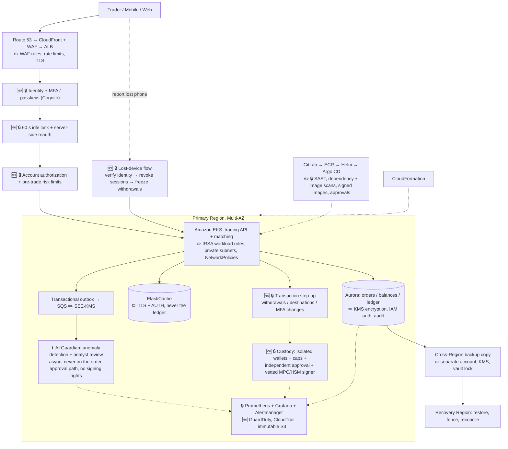

# Problem 5: Fortify the Castle

**Security integrated into the Problem 1 trading-platform architecture**

**Status: design complete. All controls are proposed, not implemented. The MVP uses simulated funds and signing and is not a production custody system.**

Source: *AWS Trading Platform v2: added security features* (see [`docs/`](../../docs/README.md)). Base architecture: [Problem 1](../problem1/SOLUTION.md).

**Legend:** 🔒 **MUST** = I would refuse to ship real-money trading without it · ➕ **OPTIONAL** = later enhancement · 🆕 = added to the design · ✏️ = changed in the design · ✅ = risk accepted as-is

---

## 1. Priorities: what I secure first

1. **User access:** stop unauthorized account actions (identity, MFA, session lock, revocation, authorization).
2. **Funds and ledger:** custody isolation, withdrawal safeguards, ledger integrity and reconciliation.
3. **Platform, availability and recovery:** encryption, secrets, workload identity, audit, detection, DR.
4. **AI-assisted detection:** only on top of deterministic controls, never instead of them.

## 2. Updated architecture (security changes marked)

> Redrawn from the security workflow diagram in the source PDF (page 8). The original detailed diagram (page 9) is in [`docs/`](../../docs/README.md).

**What I changed vs Problem 1:**
- 🆕 Added an explicit **trust chain** in front of EKS: identity → session lock → authorization.
- 🆕 Added **withdrawal step-up** as a hard gate in front of custody.
- 🆕 Added an out-of-band **lost-device** flow.
- ✏️ **Guardian moved off the decision path**: asynchronous, no signing, no transfer permission.
- ✏️ Hardened existing components: WAF, IRSA, KMS, TLS, private subnets, backups in a separate account.

## 3. Controls: what, why, what it protects against, trade-off

| # | Control | Priority | Protects against | Trade-off |
|---|---|---|---|---|
| 1 | **MFA, passkeys preferred** (Cognito); admins protected separately | 🔒 | Credential stuffing, phishing, password reuse | Recovery complexity; vendor flow constraints |
| 2 | **60-second interactive inactivity lock, server-enforced** | 🔒 | Unattended unlocked device, shoulder-surfing, session reuse | User friction (mitigated by fast passkey unlock); custom implementation |
| 3 | **Lost-device report → server-side revocation → withdrawal freeze** | 🔒 | Stolen phone used to drain the account | Needs verified reporting and a support process |
| 4 | **Server-side authorization per account and action**; rate limits; replay prevention; idempotency; scoped API keys | 🔒 | IDOR, privilege escalation, replay, duplicate orders, abusive bots | Policy testing effort |
| 5 | **Withdrawal step-up**: fresh phishing-resistant auth bound to the transaction details; limits; allowlists; holds | 🔒 | Account takeover cashing out; tampered destinations | Extra prompt on high-risk actions only |
| 6 | **Segregated hot wallets** per asset and network; caps; independent approval; vetted MPC/HSM signer; sweep to cold | 🔒 | Single key compromise draining everything; insider fraud | Liquidity operations overhead; provider evaluation |
| 7 | **Reconciliation**: chain vs custody vs ledger; pause on mismatch | 🔒 | Silent loss, ledger corruption, double spend | Withdrawals pause on discrepancies |
| 8 | **Workload identity** (IAM roles for EKS service accounts); no static keys | 🔒 | Leaked long-lived credentials | Role policy maintenance |
| 9 | **Secrets Manager** with rotation | 🔒 | Secrets in code, images or env files | Service cost |
| 10 | **KMS encryption at rest + TLS in transit** | 🔒 | Data exposure from snapshots, disks, network | Key policy care |
| 11 | **Audit**: CloudTrail + application and custody audit logs → immutable S3 (Object Lock) | 🔒 | Repudiation, undetected tampering, failed forensics | Storage cost; app events need their own pipeline |
| 12 | **Threat detection**: GuardDuty (incl. EKS) + operational alerting | 🔒 | Compromised workloads, crypto-mining, anomalous API use | Alert tuning |
| 13 | **CI/CD security**: SAST, dependency and image scanning, protected branches, approvals, pinned and signed images | 🔒 | Supply-chain compromise, vulnerable deps | Findings triage |
| 14 | **Network isolation**: private subnets, security groups, NetworkPolicies, VPC endpoints | 🔒 | Lateral movement, data exfiltration | Design and debug effort |
| 15 | **Backups**: cross-Region, separate account, encrypted, tested restore | 🔒 | Ransomware or deletion, Regional loss | Cost; RPO > 0 needs reconciliation |
| 16 | **AI Guardian**: async anomaly detection, risk cases, analyst review | ➕ | Subtle abuse patterns rules miss | False positives; model tuning; must start in shadow mode |
| 17 | **Device attestation** (App Attest / Play Integrity) as a risk signal | ➕ | Tampered, emulated or rooted clients | Platform-specific; not proof of fraud |
| 18 | Trusted-device management, configurable withdrawal delays, extra security keys | ➕ | Takeover on new devices | Friction |

## 4. Key design decisions

### 60-second interactive lock
- After **60 s without deliberate user interaction**, the *interactive* session locks: private screens are hidden and the **server denies sensitive API and WebSocket actions** until reauthentication. This is a lock, not necessarily a logout.
- **Price ticks, WebSocket pings and background refresh do not reset the timer.** The server tracks the last real user action.
- Unlocking needs a **fresh server-verified WebAuthn/passkey challenge**. A local biometric UI unlock alone does not reactivate the server session.
- On mobile backgrounding, cover sensitive content immediately and revalidate on resume. A web SPA cannot reliably detect a screen lock, so it treats uncertainty conservatively.
- 🔑 **Open orders and API bots follow separate policies.** A lock does not cancel open orders, stop bots or cancel withdrawals. Bots use separate scoped API keys with expiry, optional IP allowlists and explicit revocation.

### Revocation must be server-side
A revoked Cognito token can still pass a local JWT signature-and-expiry check. So every protected API and WebSocket request checks a **server-side session/version store**, with bounded cache propagation. **Fail closed** for sensitive actions when revocation status cannot be verified. Measure and document the worst-case revocation delay.

### Lost or stolen device
The exchange does not *know* a phone was stolen; the customer has to report it.
1. Customer reports via a verified web session, an enrolled recovery method or trained support, and chooses the scope (device or whole account).
2. Atomically revoke affected sessions and refresh tokens; sever or revalidate WebSockets; notify via an independent channel.
3. Freeze new withdrawals; pause pending withdrawals if still stoppable. Broadcast on-chain transactions cannot be reversed.
4. Show open orders, API keys and pending withdrawals; **do not silently cancel** them without authorization or a disclosed emergency policy.
5. Restore through verified recovery with new passkey/MFA enrollment; log and review.

### AI Guardian boundaries
Deterministic rules run **before** order acceptance. The Guardian consumes committed events **asynchronously**, may propose or apply pre-approved account restrictions through a separate policy service, and **can never sign or transfer assets**. If the Guardian is down or lagging: alert, fall back to deterministic rules, and follow documented fail-open/fail-closed rules.

### Dynamic hot wallets
Keep only forecast withdrawals + fees + buffer in each hot wallet, within approved min/max caps. Top-ups and sweeps need independent approval, allowlisted destinations, cooldowns and signer-level policy. Example: hold 0.40 BTC + 0.10 BTC reliably in transit against a 0.85 BTC target → propose a 0.35 BTC top-up; otherwise hold and investigate. Distinct addresses alone ≠ key isolation.

## 5. Risk accepted as it stood ✅

| Item | Why it's acceptable |
|---|---|
| Single primary Region + backup-and-restore DR (no active-active) | Security doesn't require it; cost stays low. RPO > 0 is handled by reconciliation before resuming |
| Self-managed Prometheus/Grafana | Not on the trust path; still gets its own access controls |
| ALB instead of API Gateway | WAF + app-level rate limiting + authorization cover the gap |
| Public market data without login | No private data; protected by WAF and rate limits |
| Single EKS cluster | Namespaces, NetworkPolicies and IRSA give enough isolation for the pilot |

## 6. What I deliberately left out (deferred)

- Production custody, real keys, real funds and live custody integrations (**simulated in the MVP**).
- KYC/AML operations, travel rule, market surveillance at scale, fiat rails.
- Independent pen test, custody audit and regulatory certification (required **before** real money, separately scoped).
- An external SIEM (Splunk etc.): start with CloudTrail + GuardDuty + immutable S3; add a SIEM when the investigation volume justifies the cost.
- Amazon Verified Permissions: in-service authorization first; revisit when policies grow.
- ML models in enforcement: shadow mode only until evaluated.

## 7. Facts I don't have, how I'd get them, what I assumed

| Missing fact | How I'd get it | Assumed meanwhile |
|---|---|---|
| Regulatory regime and licensing | Legal/compliance review | Out of scope; flagged as a pre-launch gate |
| Custody provider and supported chains | Vendor evaluation (MPC/HSM, chain coverage, SLAs) | Simulated signer; vetted provider or MPC/HSM in production |
| Real threat model and attacker profile | Threat-modeling workshop (STRIDE) with security and trading ops | Account takeover + hot-wallet compromise are the top threats (cf. reported October 2026 exchange wallet breach, attack path to be confirmed by investigation) |
| Withdrawal volumes and liquidity needs | Treasury and historical data | Caps in the diagrams are placeholders |
| Acceptable user friction | UX testing with active traders, accessibility review | 60 s lock + fast passkey unlock |
| Revocation latency budget | Product + security agreement, then measurement | Seconds, with fail-closed on sensitive actions |
| GitHub/GitLab plan features (environment reviewers etc.) | Check the subscription | Use an external gate if a feature is unavailable |

## 8. Would refuse to ship real money without

Strong authentication and recovery · enforced session and device revocation · server-side authorization and step-up · ledger correctness and reconciliation · independent custody controls · withdrawal safeguards · logging and monitoring · tested backups and recovery · incident response and support · **independent security review**. AI and device attestation are **not** substitutes for any of these.

## 9. Security acceptance tests

- Idle 59 s → still usable; at 60 s, sensitive API **and** WebSocket actions are denied until server-verified reauth. Also test clock skew, sleep/resume, offline mode, and that heartbeats don't reset the timer.
- Device-loss report → old tokens rejected, WebSockets terminated within the documented objective; test cache staleness and auth-store outage.
- Account freeze blocks new withdrawals; follows the policy for pending and broadcast ones; recovery works without the lost phone.
- Step-up cannot approve a *modified* transaction and cannot be replayed.
- Guardian cannot access keys or sign transactions.
- Metrics: time to unlock, auth success and abandonment, false lockouts, revocation latency, withdrawal holds, added p95/p99 latency.

**References:** [NIST SP 800-63B-4](https://pages.nist.gov/800-63-4/sp800-63b.html) · [OWASP Mobile Application Security Cheat Sheet](https://cheatsheetseries.owasp.org/cheatsheets/Mobile_Application_Security_Cheat_Sheet.html)
